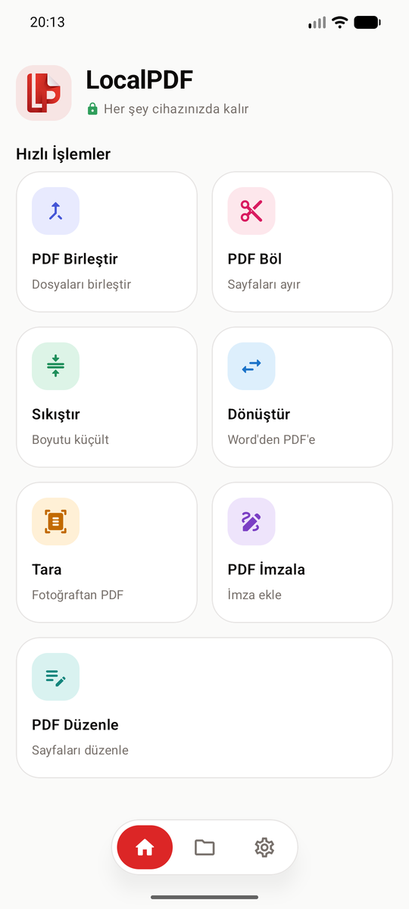
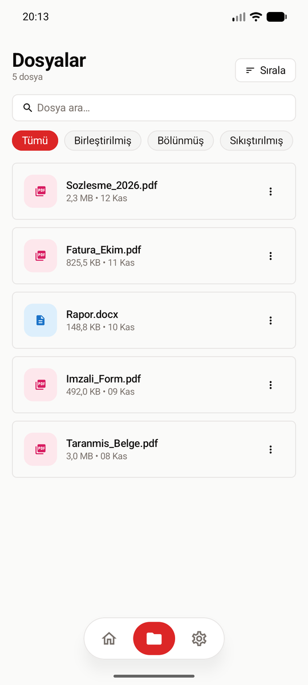
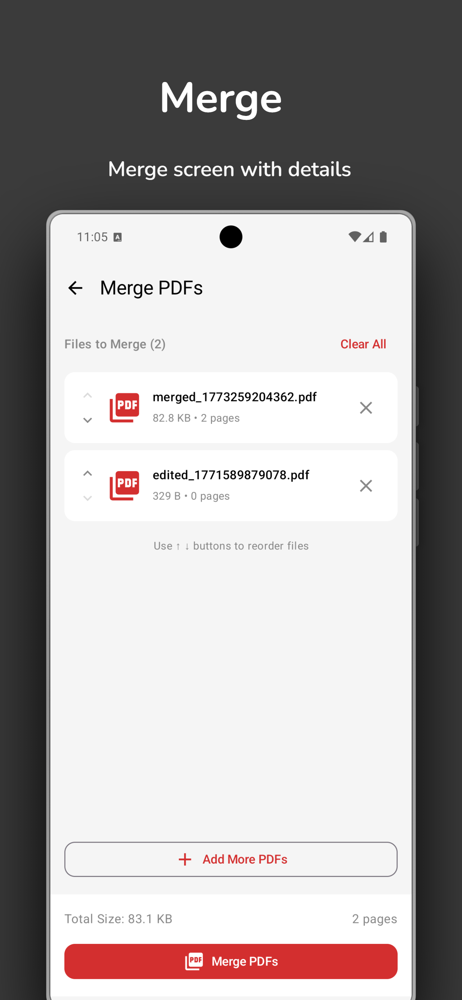
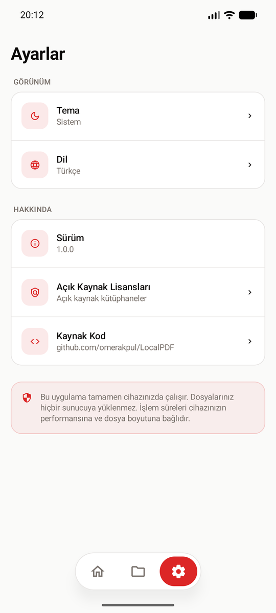

# LocalPDF 📄

<p align="center">
  
  
  
  
  
</p>

An **offline** Android PDF toolbox built with modern Android development practices. LocalPDF performs its PDF operations directly on your device. The app does not request the internet permission, so your documents never leave your phone. See the [Privacy Policy](PRIVACY.md).

## 📱 Download APK
You can download the latest APK from the [Releases](../../releases) section and test the application directly on your Android device.

## ✨ Features

* **In-App PDF Viewer:** Smooth PDF rendering with pinch-to-zoom.
* **Open with LocalPDF:** Open or share a PDF from any other app (file manager, mail, browser) straight into LocalPDF.
* **Merge PDFs:** Combine multiple PDF documents into a single file.
* **Split PDFs:** Extract specific pages or split a PDF into smaller parts.
* **Compress PDFs:** Shrink a PDF by recompressing its embedded images (text stays selectable), with a size estimate and progress bar.
* **Convert:**
  * Word (`.docx`) → PDF, keeping bold/italic text, font sizes, headings, alignment, bullet lists and basic tables
  * PDF → Word (text)
  * PDF → Images (PNG, saved to `Pictures/LocalPDF`)
* **Photo to PDF:** Select multiple images from your gallery and turn them into a single PDF.
* **Sign PDF:** Draw your signature, then drag and pinch it into place on a page preview. (This is a drawn signature image, not a cryptographic digital signature.)
* **Edit PDF:** Delete, rotate, reorder or duplicate pages, and add or remove a password.
* **File Management:** Recent files on the home screen plus a built-in file explorer to manage, rename, share and delete generated files; save results to Downloads.
* **Languages:** English and Turkish.

## ⚠️ Known Limitations

* Word → PDF does not render images, text boxes, headers/footers, numbered-list numbering or table styling. PDF → Word extracts text only.
* PDFs without embedded images cannot be made smaller by Compress.
* Very large files are rejected based on the device's RAM (limits range from 20 to 150 MB) to avoid running out of memory.
* On Android 8–9 saving to Downloads/Pictures may fail because no runtime storage permission is requested.

## 🛠 Tech Stack & Architecture

* **UI:** Jetpack Compose + Navigation Compose, adaptive layouts for phones and tablets
* **Architecture:** MVVM (Model-View-ViewModel) with a repository layer for stored files
* **Language:** Kotlin
* **Asynchrony:** Coroutines & StateFlow
* **Dependency Injection:** Dagger Hilt
* **Local Storage:** Room Database (schema exported to `app/schemas`)
* **PDF / Document Processing:**
  * Apache PDFBox (Android port) for PDF manipulation and encryption
  * Android `PdfRenderer` for previews and PDF → image export
  * Apache POI for reading Word documents
* **Build:** R8 code shrinking and resource shrinking in release builds

## 📸 Screenshots

<p align="center">
  
  
  
  
</p>

## 🚀 Getting Started

### Prerequisites
* Android Studio (Latest Version Recommended)
* JDK 17
* Minimum SDK: Android 8.0 (API 26) or higher

### Installation
1. Clone this repository:
```bash
git clone https://github.com/omerakpul/LocalPDF.git
```
2. Open the project in Android Studio.
3. Build and run the application on an emulator or a physical device.

### Build and test from the command line
```bash
./gradlew testDebugUnitTest assembleDebug
```
Pull requests run the same command through GitHub Actions.

## 🏷️ Releases

Pushing a tag such as `v1.2.3` builds, signs and publishes the APK. The tag sets the app version: `versionName` becomes `1.2.3` and `versionCode` becomes `major * 10000 + minor * 100 + patch`.

## 🛡️ License
This project is licensed under the MIT License - see the [LICENSE](LICENSE) file for details.
